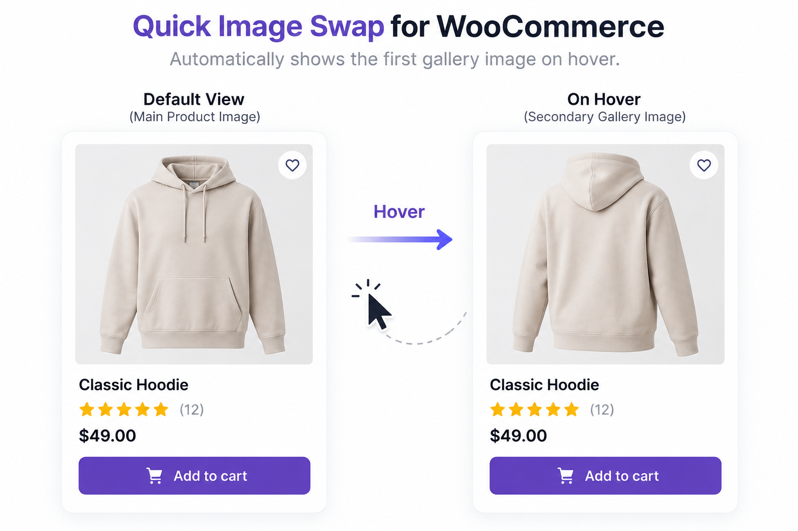

# Quick Image Swap for WooCommerce

- Contributors: PluginsKart
- Tags: woocommerce, product image, product gallery, hover image, product hover
- Requires at least: 6.7
- Tested up to: 7.1
- Requires PHP: 8.1
- Stable tag: 1.0.0
- License: GPL-2.0-or-later
- License URI: https://www.gnu.org/licenses/gpl-2.0.html

Add a CSS-only hover image swap to WooCommerce product loops and Product Collection blocks with no JavaScript required.

## Description

Quick Image Swap for WooCommerce displays the first image from a WooCommerce product's gallery when visitors hover over the product image.

The plugin is designed for WooCommerce product listing pages, including WooCommerce Product Collection blocks and classic WooCommerce product loops.

It provides a simple CSS-based hover effect without requiring JavaScript or a configuration page.

The plugin does not modify the product image gallery on single-product pages.

The PRO feature is license-gated. Activate the plugin from **Settings -> Quick Image Swap -> Licensing** before the hover image feature is enabled.

## Licensing SDK Integration

The plugin includes a small PluginsKart licensing facade under `includes/licensing/` and a WordPress admin licensing screen.
It uses the local PluginsKart SDK API mock by default and does not make requests until
one of these methods is called:

```php
$licensing = pkart_quick_image_swap_licensing();

$activation = $licensing->activate(
	'PKMOCK-2026-TEST-0001',
	'quick-image-swap-for-woocommerce',
	home_url(),
	'1.0.0'
);

$validation = $licensing->validate(
	'PKMOCK-2026-TEST-0001',
	'quick-image-swap-for-woocommerce',
	home_url(),
	'1.0.0'
);

$update = $licensing->update(
	'PKMOCK-2026-TEST-0001',
	'quick-image-swap-for-woocommerce',
	'1.0.0'
);
```

Switch the API base URL with the `pluginskart_quick_image_swap_license_api_url`
filter when connecting to the production API. The mock API key
`PKMOCK-2026-TEST-0001` activates the local development flow.

## Features

* Display the first product gallery image on hover.
* Supports WooCommerce Product Collection blocks.
* Supports classic WooCommerce product loops.
* Uses the WooCommerce thumbnail image size.
* CSS-only hover effect.
* No JavaScript required.
* No shortcode required.
* PRO license activation, validation, and deactivation.
* Automatically skips products without gallery images.
* Does not modify single-product pages.
* Lightweight frontend implementation.
* Uses the product-secondary-image CSS class for customization.

## How It Works

When a product has at least one gallery image, Quick Image Swap for WooCommerce adds the first gallery image as a secondary image in the product listing.

When a visitor moves the mouse over the product image, the secondary gallery image becomes visible using a CSS transition.

The plugin works automatically after activation.

No additional configuration is required.

## Installation

### Method 1: WordPress Admin

1. Make sure WooCommerce is installed and activated.
2. Upload the plugin ZIP file through Plugins > Add New Plugin > Upload Plugin.
3. Install the plugin.
4. Activate Quick Image Swap for WooCommerce.
5. Visit your WooCommerce shop or product archive.
6. Hover over a product image that has a gallery image.

### Method 2: Manual Installation

1. Extract the plugin ZIP file.
2. Upload the plugin folder to: /wp-content/plugins/
3. Log in to the WordPress dashboard.
4. Go to Plugins → Installed Plugins.
5. Locate "Quick Image Swap for WooCommerce".
6. Click Activate.

The first gallery image will appear when hovering over the product image.

No additional CSS configuration is required.

## Frequently Asked Questions

### Does the plugin require WooCommerce?

Yes. Quick Image Swap for WooCommerce requires WooCommerce.

### Does the plugin work with WooCommerce Product Collection blocks?

Yes. The plugin supports WooCommerce Product Collection blocks.

### Does the plugin work with classic WooCommerce product loops?

Yes. The plugin supports classic WooCommerce product loops.

### Does it work on single-product pages?

No. The plugin is intended for product listing and archive pages and does not modify the single-product image gallery.

### Which image is displayed on hover?

The first image from the product's WooCommerce gallery is displayed.

### What happens if a product has no gallery image?

The product's main image remains unchanged. No secondary image is added.

### Does the plugin use JavaScript?

No. The hover effect is handled entirely with CSS.

### Do I need to configure the plugin?

No. The plugin works automatically after activation.

### Can I customize the hover effect?

Yes. The secondary image uses the product-secondary-image CSS class. You can customize its appearance and transition using your theme's CSS.

## Screenshots

The plugin currently includes the following screenshots in the `assets` folder:

- `assets/screenshot-1.png` — product image before hovering
- `assets/screenshot-2.png` — product image displaying the first gallery image on hover

```md


```

These screenshots should use a clean product catalog layout and the same aspect ratio for a consistent display in the WordPress plugin directory. If needed, you can also add an optional `assets/screenshot-3.png` later.

## Customization

The secondary image uses the following CSS class:

`product-secondary-image`

You can use this class to customize the hover image transition and appearance.

## Privacy

Quick Image Swap for WooCommerce does not collect, store, or transmit personal data.

The plugin does not connect to any external service.

## Requirements

- WordPress 6.7 or later
- WooCommerce
- PHP 8.1 or later

## Changelog

### 1.1.0

- Added support for classic WooCommerce product loops.
- Improved WooCommerce Product Collection block support.
- Updated secondary image handling.
- Improved accessibility of the secondary image.
- Updated documentation.
- Improved compatibility with WooCommerce product thumbnails.

### 1.0.1

- Added WooCommerce Product Collection block support.
- Added the first gallery image as a secondary product image.
- Added CSS-based hover functionality.
- Added the product-secondary-image CSS class.
- Excluded single-product pages.

## Upgrade Notice

### 1.1.0

Improved WooCommerce compatibility and added classic product loop support.
